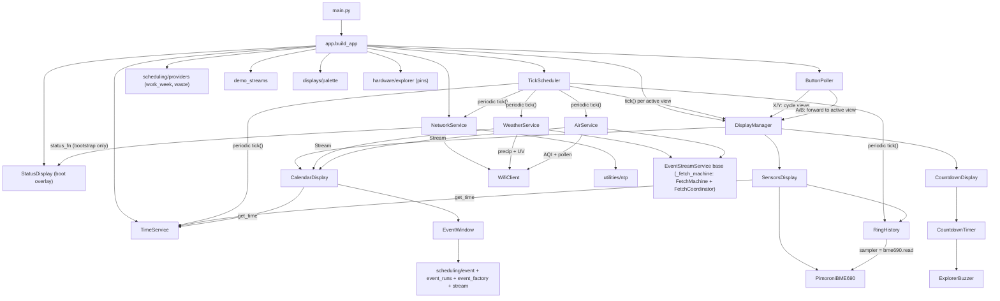

# Copilot instructions (pico-explorer-playground)

MicroPython app for the Pimoroni Pico Explorer (RP2040), built on PicoGraphics. See `README.md` for layout/setup, `ROADMAP.md` for feature state and design intent, and `src/pico/config_defaults.py` for the config schema.

## Deployment boundary
Everything under `src/pico/` is uploaded *verbatim* to the device (MicroPico, `"micropico.syncFolder": "pico"`) and consumes flash, so keep it to runtime code the app actually imports. Everything else lives outside it: host tests → `src/tests/`, build/codegen tooling → `src/tools/`, source art → `src/assets/`, reference data and scratch docs → `src/docs/`.

## Runtime constraints (MicroPython 1.27.0 / RP2040, Pimoroni build)
- Display: `PicoGraphics(display=DISPLAY_PICO_EXPLORER)`.
- Avoid allocations in hot paths (render loop, timer callbacks). Reading `obj.method` as a value allocates a new bound method (calling `obj.method(...)` doesn't), so cache a ref passed repeatedly — on every `schedule(...)`, or to a timer's `init()` per activation — in `__init__` (`self._tick_ref = self._tick`). Bound methods compare and hash by `(self, method)`, not identity (verified on-device). A nested `def` or `lambda` allocates a function object each time it executes, so hot-path helpers live at module or class level, with their caller's emitter decorator (`@micropython.native`).
- **Timer callbacks are soft** (verified on-device): `machine.Timer` defaults to `hard=False` and no timer here passes `hard=True`, so each firing is queued like a `micropython.schedule(...)` call (dropped silently when the queue is full) and runs on the main thread; it may allocate but should stay short. Firings queued behind a blocking callback (e.g. an HTTP fetch) run back-to-back once it returns, so where they should collapse rather than burst (`TickScheduler`, `PimoroniBME690`, `WifiClient`), the callback only schedules the work behind a `_pending` flag and returns early while it is set — keep that hop. It collapses a backlog; it doesn't space runs apart. `schedule()` raises `RuntimeError` when the queue is full: roll `_pending` back so one failure doesn't wedge the state machine.
- **Single Python thread:** timer and scheduled callbacks and the main-loop button poll share one thread (no event loop, no background thread), so blocking work in a `schedule(...)` callback (e.g. an HTTP fetch) freezes rendering *and* buttons until it returns. Network fetches use a tick-driven fetch machine (`services/_fetch_machine.py`, owned by `services/_event_stream_service.py`) with a short `config.HTTP_TIMEOUT_S` per socket operation (DNS lookup isn't covered), not `asyncio`/`_thread` (lwIP isn't multi-core-safe, and rp2 `_thread` runs on core 1 without a GIL, so shared state would race).
- Prefer `const(...)`; keep math integer where possible.
- **Swallowed exceptions:** print them with `utilities.log.log_exception(tag, exc)`, passing a preformatted `tag`.
- **Allocation traps (verified on-device):** the build's `time` epoch is **1970**, so `time.time()` / `TimeService.now()` exceed the 2³⁰ small-int limit (2026 ≈ 1.78e9) and **heap-allocate a big int every call** — gate wall-clock reads in per-tick / per-render paths behind the alloc-free `time.ticks_ms()` (`TimeService._tick` checks the DST boundary ~once/60 s; the Sensors header reads the clock only at minute boundaries, not every render). **Floats are boxed (~16 B)** and `array('f')` re-boxes on each read, so a tuple holding float objects beats an `array('f')` when the values are read more than once (why `PimoroniBME690.read()` returns a tuple). `range(n)` is alloc-free; `enumerate(...)`, tuple/list literals, and float arithmetic each allocate. GC is mark-sweep (no refcounting), so even transient objects accumulate until `gc.collect()` (the steady-state sawtooth).
- **PEN_P4 framebuffer + boot palette:** `main.py` creates the `PEN_P4` framebuffer (4-bit indices into a 16-slot palette — half the RGB332 size, freeing the contiguous heap on-device TLS needs) then calls `displays.palette.program_palette(gfx)` to write all 16 slots *before* `from app import build_app`. A pen is just its slot index 0-15; `displays/palette.py` is the single source of the colour language (`PALETTE_RGB`, slot consts, `LABEL_FOR_SLOT` auto-contrast for text on coloured bars/markers).
- **Network memory:** HTTPS/TLS *and* large HTTP responses both hit ENOMEM on the fragmented heap (mbedtls needs a ~16 KiB contiguous block; `requests` allocates ~response-size). So Open-Meteo is fetched over **plain HTTP** (public/keyless) with a small `forecast_hours` window — the air-quality body at `forecast_days=2` (~2.5 KiB) failed "allocating 2560 bytes"; ~4 h keeps each body <1 KiB. Bound response size for any new fetch.

## Virtual timer budget
`machine.Timer(-1)` allocates a *virtual* (software) slot; the Pimoroni build has only a small fixed pool (observed ≈ 8–10) and `deinit()` lingers, so rapid create/deinit churn can exhaust it. **Reuse a long-lived `Timer` over creating one per activation; update this table when adding an owner.** If your change introduces a new `machine.Timer` owner, you MUST add a row to the Timer budget table in this file and recount the steady-state total before presenting the code.

| Owner | File | Lifetime |
|---|---|---|
| `TickScheduler._timer` | `services/tick_scheduler.py` | permanent — drives all periodic subscribers |
| `PimoroniBME690._timer` | `services/pimoroni_bme690.py` | permanent — constant-interval gas-safe reads |
| `ExplorerBuzzer._alert_timer` | `services/explorer_buzzer.py` | permanent object, cycled via `init()` / `deinit()` per alert |
| `WifiClient._timer` | `services/wifi_client.py` | transient — only while `CONNECTING` |

Steady state: 3 permanent + ≤1 transient = 4 max.

## Architecture

**Patterns** (the non-obvious *why*; mechanics live in the code):

- **Entry point:** `main.py` is thin — bootstraps config, allocates the `PEN_P4` framebuffer, programs the 16-colour palette (`program_palette`), then `app.build_app(pico_graphics, micropython.schedule)` returns an `App` bag (`display_manager`, `tick_scheduler`, `button_poller`, `network_service`). `app.py` is the single composition site for services + displays.
- **Composition-root derivations (single source of truth):** a value that's a function of *other* modules' constants — or shared by several — gets one owner and is derived + injected from `app.py` (which already wires both ends), never hardcoded in a leaf module. The owner exposes that constant **public** (`WINDOW_FUTURE_SEC`, not `_…` — MP drops `_`-prefixed `const` from the module namespace, so it can't be imported); consumers take it as a required param and stay layer-independent (`services/` never imports `displays/`). A magic number justified only by a comment is a smell — derive it when the inputs are reachable (the network-streams `forecast_hours` below is the worked example).
- **Displays** inherit `displays.base.Display` (no-op `initialize` / `deinitialize` / `render` / `on_button_a` / `on_button_b`); the `refresh_period_ms` class attr sets redraw cadence (default `1000`; `0` = render every scheduler tick). `DisplayManager` rebuilds one `RefreshGate` per view switch; A/B presses reset the gate *only* when the active view overrides the base handler (stray presses on passive views don't disturb cadence).
- **TimeService:** central time authority — RTC holds UTC, `now()` returns local epoch (TZ + DST). Must be created *after* NTP sync; exposes `to_utc()` / `total_offset()` / `real_duration()` for DST-aware math. Consumers pass `time_service.now` as `get_time`.
- **NetworkService:** `status_fn` is a kwarg on `connect_and_sync_initial(...)` only, not the constructor — periodic resyncs are silent so they never clobber the active view.
- **RingHistory** (`services/ring_history.py`): generic N-metric ring buffer; takes a positional `sampler` (a bound method, no closure) plus keyword `num_metrics` / `capacity` / `ticks_per_commit`, and bumps `commit_count` so consumers detect new data cheaply; `update_latest(metric_idx, value)` overwrites the newest sample of *one* metric without advancing the ring (the gas warm-up backfill, below). The Sensors view uses one instance (`num_metrics=4`) for 24 h of BME690 history, registered once in `app.py` via its cached `_tick_ref` (no new `Timer`).
- **Sensor bands:** `config.SENSOR_*_BANDS` are 5-tuples (shape documented in `config_defaults.py`). *Structural* shape is enforced by `config_bootstrap.apply_overrides`; *semantic* invariants (strictly ascending, unique) by `_validate_sensor_bands_or_halt` in `app.py`.
- **Gas warm-up / backfill (sensors):** the BME690 metal-oxide gas sensor needs heater warm-up, so its reading is invalid for the first seconds after boot. `PimoroniBME690.read()` returns **NaN** for gas while the heater is `Unstable` (the value text shows `"warming…"`; the gas icon + graph are gated on the `"Stable"` status, so NaN is never drawn/formatted). `RingHistory`'s immediate boot commit therefore stores valid temp/press/hum but **NaN gas** (the graph skips NaN columns); the Sensors view **backfills the newest gas slot (`RingHistory.update_latest`) the instant the heater goes stable**, so the gas column appears as soon as the reading is valid rather than at the next periodic commit. Each metric's band `(icon, fill)` is colocated in `sensors.Display.ROWS` (single source); the Display derives its `band_pens` from it (`sensors.build_sensor_band_pens`).
- **Services** (`services/`) are long-lived, created at startup, independent of display lifecycle. Explorer- / Pimoroni-specific ones use `Explorer*` / `Pimoroni*` names to avoid shadowing built-in MP modules.
- **Scheduling** (`scheduling/`): `Event` carries DST-corrected durations plus a `color_index` into `displays/palette.STREAM_COLORS` (mapped to pens once in `app.py`); `EventWindow` is the per-row calendar view-model (reuses an internal buffer). It prunes before and during catch-up so time away from Calendar cannot pin expired history; pruning follows the renderer's next-start clipping so an interrupted long event neither pins its successors nor reappears after they expire. `Stream` bundles a row's `events_iter` plus optional refresh / status hooks used by network streams. `event_runs.py` holds the pure bar-assembly primitives shared by the network services: `level` (threshold→0/1/2), `best_by_priority` (per-hour conflict pick), `merge_runs` (contiguous equal `(label,color)` hours → `Event` bars).
- **Network calendar streams** (`services/`): `WeatherService` (precip + UV, one Open-Meteo *forecast* fetch) and `AirService` (AQI + pollen, one *air-quality* fetch — separate host) are thin `EventStreamService` subclasses (only `_fetch_and_parse` + config differ): the base owns the fetch loop — *when* to fetch (interval + exponential backoff), the `status`/`generation` the calendar polls, and publishing — driving a stateless `FetchMachine` over a transient `FetchState` (allocated per fetch, GC'd once the owner harvests its result on the next tick). A shared `FetchCoordinator` serialises fetches (one thread → not for safety, but so two services due in the same tick don't freeze rendering back-to-back). They publish `Event` bars the calendar reads passively. A row bundles temporally anti-correlated metrics; per-hour conflicts resolve **at fetch time** by priority (`event_runs.best_by_priority`) so the render path stays allocation-free. The calendar windows (`displays/calendar.WINDOW_*_SEC`, public) are *owned by the calendar*; `app.py` owns the fetch cadence and **derives** both `forecast_hours = ceil((WINDOW_FUTURE_SEC + 2×refresh + 1 h)/1 h)` and `past_hours = ceil(WINDOW_PAST_SEC/1 h)` (the API's `forecast_hours` starts at the current hour, so `past_hours` keeps the past strip populated), injecting cadence + both horizons into the services (no value is hardcoded in the services or `openmeteo_client`).
- **Stream providers** (`scheduling/providers/`, namespace packages — no `__init__.py`): pure on-device generators built once at boot — `work_week` and `waste` (`config.WASTE_SCHEDULE`). `demo_streams.py` fills remaining calendar rows and is temporary (see `ROADMAP.md`); its cursor skips unseen obsolete history rather than constructing weeks of random events on re-entry. `app.py` injects the calendar-owned past horizon so rebasing preserves the past strip and already-yielded events.
- **Hardware / assets:** `hardware/explorer.py` centralizes GPIO pin constants. Icons are 4-bit palette-indexed blobs in `displays/shared/_icons_data.py` (generated from the per-icon PNGs in `src/assets/*.png` via `src/tools/icons-to-p4.py`), drawn by the tiny `displays/shared/icons_p4.py` blitter (`sprite()`/`load_spritesheet` are RGB332-only, unavailable under P4). The 16-colour palette is defined once in `displays/palette.py`; the host tools (`icons-to-p4.py`, `palette_cvd_check.py`) import `PALETTE_RGB` from it so the colours can't drift, and `palette_cvd_check.py` re-verifies CVD-distinguishability.

## Testing
- Host pytest: `cd src && python -m pytest -q` (no MicroPython runtime needed).
- `src/tests/conftest.py` shims MP-only modules (e.g. `micropython`, `machine`, `picographics`, `pimoroni`, `pimoroni_i2c`, `breakout_bme69x`, `ntptime`, `network`, `urequests`), the `const` builtin, `sys.print_exception`, and MP `time` funcs (`ticks_ms` / `ticks_diff` / `ticks_add` / `sleep_ms`, plus `mktime` / `gmtime` in UTC).
- Services / displays are tested via direct method calls with injected fakes (`schedule`, `timer_factory`, `pwm_factory`, `pin_factory`, `get_time`) — no real timer / schedule mocking.
- Use `_fakes.bitmap8_width(text, scale)` to measure text width in tests.
- `test_calendar_selection.py` exercises `_build_calendar_display` with default config, a recording panel, and empty network streams, including first entry and re-entry after a long absence. Full `build_app` hardware composition is not host-tested, so verify other wiring changes manually and on-device.

## Coding conventions
- Minimal, targeted edits; keep public behavior stable unless asked. Keep MicroPython compatibility (no CPython-only modules unless guarded). Small functions, clear names.
- **Comments: none by default**, docstrings included, in runtime code, tests, fakes and tools alike. Say each thing once, on the first rung that can carry it to a developer fluent in Python and MicroPython but new to this code. State it next to the code it originates in; state a contract on the outermost item whose callers rely on it. Code relying on it doesn't restate it, and a mention in this file doesn't replace it.
  1. **Name** — every name says what its item is for, with its unit where one applies (`timeout_ms`); a literal that needs explaining becomes a named constant; annotations carry types. Where runtime constraints allow, a block that reads as one step becomes a method or module-level function.
  2. **Docstring** — required wherever the name and signature leave a caller guessing what the item does or is for, or what it requires and guarantees; it holds only what they don't say: a summary, then any contract, warning, reason or meaning. State the contract even where the body shows it, since people often read the docstring, not the body. Don't document what the code does when a caller breaks a stated precondition, such as an excluded argument or a call in the wrong state; what it does with any other input, such as a silent clamp or a raised error, is contract. A module docstring holds only the module's purpose, never a class's or function's. Overrides of a documented base method, and fake methods mirroring the API they fake, need none.
  3. **`#` comment** — what someone changing the code couldn't work out within seconds from it, its names and its docstring: a reason, a warning, a meaning, or a summary of a block that stays inline.
  - **Keep** only these kinds, even where a test also pins them:
    - *Summary* — what an item or block does or is for, in one line where possible.
    - *Contract* — the code's guidance to its callers: what they must do and may rely on, as the code defines it, not as its current callers use it.
    - *Warning* — what breaks if this code changes, callers included; an instruction that omits the consequence isn't a warning.
    - *Reason* — why the code is shaped this way, MicroPython and hardware constraints especially.
    - *Meaning* — what a value, encoding, layout or displayed text means or looks like.
  - **Delete** who calls this code, how a caller works or what it does with the result (telltale: adding or removing a caller would make the sentence false); restatements of the name, signature or next line; in a test, what it asserts; and a change's history (the commit message holds that).
  - **Replace** any other claim about what the code does with a test, if a test could check it: a test fails when the claim stops being true, a comment doesn't.
  - In a test, repeat the reason behind runtime code only when that reason isn't obvious.
  - Check every mechanism you state against the code, and against the MicroPython source where it rests on non-obvious MicroPython behavior.
- **Renames and extractions are code changes:** apply rung 1 to code you write or change. A comment-only change keeps any comment a better name would carry and proposes the rename, which then deletes it.
- **`config_defaults.py` keeps its comments**, which the rules above never remove: they are the config schema's user-facing documentation. Trim or reword them only where clarity doesn't suffer.
- **Mandated comments** — the rules above never remove these: an annotation MicroPython can't express becomes a comment with its intended signature (type hints below). A suppression names its specific code (`# type: ignore[attr-defined]`, `# noqa: E402`); a bare `# type: ignore` is only for imports of MicroPython-only modules. Shebangs and generated-file headers are exempt too.
- **Before reporting a `.py` change done**, reread every comment and docstring you added, changed or deleted — all of `git diff -U0 <start> -- '*.py'` (`<start>`: the commit the task began from; skip hunks that predate the task), each new untracked `.py` file (`git ls-files -o --exclude-standard -- '*.py'`), and each touched docstring in full, plus the docstring of each item whose code you changed. Restore what the rules above keep, delete what they don't allow, and add what they require.
- Type hints — annotate function and method signatures; annotate a variable only when its initializer doesn't reveal its type (`self._wlan: WLAN | None = None`, `events: list[Event] = []`, but `self._gate = self._build_gate(display)`). Apply this decision table in order:
  1. If the type is fully expressible in MicroPython (`int`, `str`, `list[X]`, `tuple[X,…]`, `X | None`): annotate normally — use full generics (`list[Event]`, `tuple[int, int, int, int]`), never bare `list` / `tuple`.
  2. If the type is not expressible in MicroPython (`Callable`, `Iterator`, `Generator`): omit the annotation; add an inline comment with the intended signature (e.g. `# () -> int`, `# Iterator[Event]`).
  3. If only the element type is unhintable or duck-typed: use bare `list` or `list[tuple]`; never use `object`.

## Config / secrets
- `config_defaults.py` is the committed schema + defaults; `config.py` is git-ignored and may hold a sparse subset of overrides. At boot `config_bootstrap.apply_overrides()` merges defaults over the user module *in place* in `sys.modules['config']`, so `import config` / `config.X` consumers work unchanged.
- **`config.py` is git-ignored but present on disk and readable** (`src/pico/config.py`) — inspect it to see the user's *actual* overrides (e.g. `LATITUDE` / `LONGITUDE`, WiFi) when debugging on-device behavior. It contains secrets (`WIFI_PASSWORD`): never echo, log, or commit them.
- Compatibility is **structural only**: each override must match its default's Python type (tuples match length + per-element type); one widening — an `int` override where the default is `float` — is allowed. Mismatch raises `InvalidConfigError` and halts. Unknown public `UPPER_SNAKE_CASE` keys warn (`config: ignoring unknown key …`) but don't halt; a missing `config.py` raises `MissingConfigError`.
- **Adding a key:** append it to `config_defaults.py` and read it as `config.X` (no `getattr` defaults; tests pass values explicitly). Remind the user to override it in `config.py` if they want a non-default value.

## Maintaining this file
Living document — when a change makes part of this file stale, edit the affected lines in the *same* change, not a deferred pass. Capture the non-obvious *why* and structural map; don't duplicate code or restate mechanics the code already makes obvious. Feature status and roadmap belong in `ROADMAP.md`.
