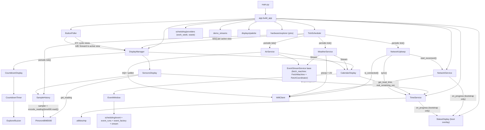

# Copilot instructions (pico-explorer-playground)

MicroPython app for the Pimoroni Pico Explorer (RP2040), built on PicoGraphics. See `README.md` for layout/setup, `ROADMAP.md` for feature state and design intent, and `src/pico/config_defaults.py` for the config schema.

## Deployment boundary
Everything under `src/pico/` is uploaded *verbatim* to the device (MicroPico, `"micropico.syncFolder": "pico"`) and consumes flash, so keep it to runtime code the app actually imports. Everything else lives outside it: host tests → `src/tests/`, build/codegen tooling → `src/tools/`, source art → `src/assets/`, reference data and scratch docs → `src/docs/`. Packages under `src/pico/` are namespace packages (no `__init__.py`).

## Runtime constraints (MicroPython 1.29.0 / RP2040, Pimoroni v1.29.0-2 build)
- Display: `PicoGraphics(display=DISPLAY_PICO_EXPLORER)`.
- Avoid allocations in hot paths (render loop, timer callbacks). Reading `obj.method` as a value allocates a new bound method (calling `obj.method(...)` doesn't), so cache a ref passed repeatedly — on every `schedule(...)`, or to a timer's `init()` per activation — in `__init__` (`self._tick_ref = self._tick`). Bound methods compare and hash by `(self, method)`, not identity (verified on-device). A nested `def` or `lambda` allocates a function object each time it executes, so hot-path helpers live at module or class level, with their caller's emitter decorator (`@micropython.native`).
- **Timer callbacks are soft** (verified on-device): `machine.Timer` defaults to `hard=False` and no timer here passes `hard=True`, so each firing is queued like a `micropython.schedule(...)` call (dropped silently when the queue is full) and runs on the main thread; it may allocate but should stay short. Firings queued behind a blocking callback (e.g. an HTTP fetch) run back-to-back once it returns, so where they should collapse rather than burst (`TickScheduler`, `PimoroniBME690`, `WifiClient`), the callback only schedules the work behind a `_pending` flag and returns early while it is set — keep that hop. It collapses a backlog; it doesn't space runs apart. `schedule()` raises `RuntimeError` when the queue is full: roll `_pending` back so one failure doesn't wedge the state machine.
- **Single Python thread:** timer and scheduled callbacks and the main-loop button poll share one thread (no event loop, no background thread), so blocking work in a `schedule(...)` callback (e.g. an HTTP fetch) freezes rendering *and* buttons until it returns. Network fetches use a tick-driven fetch machine (`services/fetch_machine.py`, owned by `services/_event_stream_service.py`) with a short `config.HTTP_TIMEOUT_SEC` per socket operation (DNS lookup isn't covered), not `asyncio`/`_thread` (lwIP isn't multi-core-safe, and rp2 `_thread` runs on core 1 without a GIL, so shared state would race).
- Prefer `const(...)`; keep math integer where possible.
- **Viper** (`@micropython.viper`) runs integer work as machine code without allocating, under rules from the MicroPython source and docs: `int(x)` converts only an int (a float raises `TypeError`), a viper function takes positional arguments only, annotations may only be `int`, `uint`, `bool`, `object` or `ptr…` (so a return type goes in a comment: `# -> None`), and native-int arithmetic wraps modulo 2³². `conftest.py`'s `micropython.viper` shim enforces the first two on host but not the wrapping, so bound every intermediate product. Anything else viper rejects surfaces only when the device compiles the module at import, so run the device compile check (Testing) before uploading. The machine code lives on the GC heap and is larger than the bytecode it replaces, so keep viper to measured hot loops.
- **Swallowed exceptions:** print them with `utilities.log.log_exception(tag, exc)`, passing a preformatted `tag`.
- **Allocation traps (verified on-device):** the build's `time` epoch is **1970**, so `time.time()` / `TimeService.now()` exceed the 2³⁰ small-int limit (2026 ≈ 1.78e9) and **heap-allocate a big int every call** — gate wall-clock reads in per-tick / per-render paths behind the alloc-free `time.ticks_ms()`. **Floats are boxed (~16 B)** and `array('f')` re-boxes on each read, so a tuple holding float objects beats an `array('f')` when the values are read more than once. `for … in range(n)` is alloc-free (a `range` object isn't); `enumerate(...)`, list literals, tuples of non-constant values, and float arithmetic each allocate. GC is mark-sweep (no refcounting), so even transient objects accumulate until `gc.collect()` (the steady-state sawtooth).
- **PEN_P4 framebuffer:** 4-bit indices into a 16-slot palette — half the RGB332 size, freeing the contiguous heap on-device TLS needs. A pen is just its slot index 0-15, and `displays/palette.py` is the single source of the colour language.
- **Network memory:** HTTPS/TLS *and* large HTTP responses both hit ENOMEM on the fragmented heap (mbedtls needs a ~16 KiB contiguous block; `requests` allocates ~response-size). So Open-Meteo is fetched over **plain HTTP** (public/keyless) with a small `forecast_hours` window — the air-quality body at `forecast_days=2` (~2.5 KiB) failed "allocating 2560 bytes"; ~4 h keeps each body <1 KiB. Bound response size for any new fetch.
- **Qstr pool (verified on-device):** the device compiles the `.py` source, so every identifier it parses — locals and `_`-prefixed `const` names included — and every str literal of up to 10 bytes is interned for good: its length + 1 bytes, plus a 6-byte slot in a pool that grows by doubling. A full boot fills about 1,180 of the first 1,260 slots. The next pool is a single 7.7 KB block, larger than a booted heap's largest free block (about 3.5 KB: `micropython.mem_info()`'s `max free sz` × 16 B), so crossing 1,260 can raise `MemoryError`; check with `micropython.qstr_info()` after the first frame. Indexing or iterating a str interns each one-character result, so test a str with its methods (`startswith`, `isupper`) instead.

## Virtual timer budget
`machine.Timer(-1)` allocates a *virtual* (software) slot; the Pimoroni build has only a small fixed pool (observed ≈ 8–10) and `deinit()` lingers, so rapid create/deinit churn can exhaust it. **Reuse a long-lived `Timer` over creating one per activation; update this table when adding an owner.** If your change introduces a new `machine.Timer` owner, you MUST add a row to the Timer budget table in this file and recount the steady-state total before presenting the code.

| Owner | File | Lifetime |
|---|---|---|
| `TickScheduler._timer` | `services/tick_scheduler.py` | permanent — drives all periodic subscribers |
| `PimoroniBME690._timer` | `services/pimoroni_bme690.py` | permanent — constant-interval gas-safe reads |
| `ExplorerBuzzer._alert_timer` | `services/explorer_buzzer.py` | permanent object, cycled via `init()` / `deinit()` per alert |
| `WifiClient._timer` | `services/wifi_client.py` | transient — only while `CONNECTING` |

Steady state: 3 permanent + ≤1 transient = 4 max.

## Architecture

**Patterns** (the non-obvious *why*; mechanics live in the code):

- **Entry point:** `main.py` stays thin; `app.py` (`build_app`) is the single composition site for services and displays.
- **Composition-root derivations (single source of truth):** a value that's a function of *other* modules' constants — or shared by several — gets one owner and is derived + injected from `app.py` (which already wires both ends), never hardcoded in a leaf module. The owner exposes that constant **public** (`WINDOW_FUTURE_SEC`, not `_…` — MP drops `_`-prefixed `const` from the module namespace, so it can't be imported); consumers take it as a required param and stay layer-independent (no service imports a view module; `displays/palette` is the shared colour language). A magic number justified only by a comment is a smell — derive it when the inputs are reachable (`app.py`'s `_STREAM_FORECAST_HOURS` is the worked example).
- **Displays** subclass `displays.base.Display`; `DisplayManager` drives the active one.
- **Time frame:** calendar and event instants are local-epoch seconds. MicroPython's `time.mktime` / `gmtime` have no time zone, so they map local fields to local epoch and back directly; only `TimeService` converts to and from UTC (the RTC holds UTC).
- **Services** (`services/`) are long-lived, created at startup, independent of display lifecycle. Explorer- / Pimoroni-specific ones use `Explorer*` / `Pimoroni*` names to avoid shadowing built-in MP modules.
- **Scheduling** (`scheduling/`): `Event` is one calendar bar, `EventWindow` a row's view-model, `Stream` a row's event source with its refresh hooks, and `event_runs` builds bars from per-hour samples for the network services.
- **Network calendar streams** (`services/`): `WeatherService` (precip + UV) and `AirService` (AQI + pollen) subclass `EventStreamService`, which owns when to fetch, backoff, freshness and publishing; a subclass supplies only `_fetch_and_parse` and its config. A row bundles metrics that rarely coincide, and per-hour conflicts resolve at fetch time (`event_runs.best_by_priority`), keeping conflict selection out of the render path.
- **Stream providers** (`scheduling/providers/`): `work_week` and `waste` (`config.WASTE_SCHEDULE`) generate events on-device. `demo_streams.py` fills the remaining calendar rows and is temporary (see `ROADMAP.md`).
- **Hardware / assets:** GPIO pins live in `hardware/explorer.py`. Icons are 4-bit palette-indexed blobs in `displays/shared/_icons_data.py`, generated from the per-icon PNGs in `src/assets/*.png` by `src/tools/icons-to-p4.py` and drawn by `displays/shared/icons_p4.py`. The host tools (`icons-to-p4.py`, `palette_cvd_check.py`) import `PALETTE_RGB` from `displays/palette.py` so the colours can't drift, and `palette_cvd_check.py` re-verifies CVD-distinguishability.

## Testing
- Host pytest: `cd src && python -m pytest -q` (no MicroPython runtime needed).
- Device compile check, before uploading a changed `src/pico/` module: `cd src && python -m mpy_cross -march=armv6m -o <scratch>/check.mpy <file>`, with the `mpy-cross` pinned in `requirements.txt` to the firmware's MicroPython; CI runs it over every module under `src/pico/` on each push to `main`. It catches what CPython accepts but the device's compiler rejects at import (viper's typing rules, ARMv6-M branch limits). Keep `-o` outside `src/pico/`: by default the `.mpy` lands beside its source and MicroPico uploads it.
- `src/tests/conftest.py` shims MP-only modules (e.g. `micropython`, `machine`, `picographics`, `pimoroni`, `pimoroni_i2c`, `breakout_bme69x`, `ntptime`, `network`, `urequests`), the `const` builtin, `sys.print_exception`, and MP `time` funcs (`ticks_ms` / `ticks_diff` / `ticks_add` / `sleep_ms`, plus `mktime` / `gmtime` in UTC).
- Services / displays are tested via direct method calls with injected fakes (`schedule`, `timer_factory`, `pwm_factory`, `pin_factory`, `get_time`) — no real timer / schedule mocking.
- Use `_fakes.bitmap8_width(text, scale)` to measure text width in tests.
- `test_calendar_selection.py` exercises `_build_calendar_display` with default config, a recording panel, and empty network streams, including first entry and re-entry after a long absence; `test_sensors_composition.py` builds the Sensors view through `_build_sensors_display` and checks the band validation. Both import `app` through conftest's `app_module` fixture. Full `build_app` hardware composition is not host-tested, so verify other wiring changes manually and on-device.

## Coding conventions
- Minimal, targeted edits; keep public behavior stable unless asked. Keep MicroPython compatibility (no CPython-only modules unless guarded). Small functions, clear names. Python lines stay within 120 characters, except in generated files.
- **Comments: none by default**, docstrings included, in runtime code, tests, fakes and tools alike. Say each thing once, on the first rung that can carry it to a developer fluent in Python and MicroPython but new to this code. State it next to the code it originates in; state a contract on the outermost item whose callers rely on it. Code relying on it doesn't restate it, and a mention in this file doesn't replace it.
  1. **Name** — every name says what its item is for, with its unit where one applies (`timeout_ms`); a literal that needs explaining becomes a named constant; annotations carry types. Where runtime constraints allow, a block that reads as one step becomes a method or module-level function.
  2. **Docstring** — required wherever the name and signature leave a caller guessing what the item does or is for, or what it requires and guarantees; it holds only what they don't say: a summary, then any contract, warning, reason or meaning. State the contract even where the body shows it, since people often read the docstring, not the body. Don't document what the code does when a caller breaks a stated precondition, such as an excluded argument or a call in the wrong state; what it does with any other input, such as a silent clamp or a raised error, is contract. A module docstring holds only the module's purpose, never a class's or function's. Overrides of a documented base method, and fake methods mirroring the API they fake, need none.
  3. **`#` comment** — what someone changing the code couldn't work out within seconds from it, its names and its docstring: a reason, a warning, a meaning, or a summary of a block that stays inline.
  - **Keep** only these kinds, even where a test also pins them:
    - *Summary* — what an item or block does or is for, in one line where possible.
    - *Contract* — the code's guidance to its callers: what they must do and may rely on, as the code defines it, not as its current callers use it.
    - *Warning* — what breaks if this code changes, callers included; an instruction that omits the consequence isn't a warning.
    - *Reason* — why the code is shaped this way, MicroPython and hardware constraints especially.
    - *Meaning* — what a value, encoding, layout or displayed text means or looks like.
  - **Delete** who calls this code, how a caller works or what it does with the result (telltale: adding or removing a caller would make the sentence false); restatements of the name, signature or next line; in a test, what it asserts; and a change's history (the commit message holds that).
  - **Replace** any other claim about what the code does with a test, if a test could check it: a test fails when the claim stops being true, a comment doesn't.
  - In a test, repeat the reason behind runtime code only when that reason isn't obvious.
  - Check every mechanism you state against the code, and against the MicroPython source where it rests on non-obvious MicroPython behavior.
- **Renames and extractions are code changes:** apply rung 1 to code you write or change. A comment-only change keeps any comment a better name would carry and proposes the rename, which then deletes it.
- **Naming** (rung 1 in practice, for code you write or change): keep names short — established abbreviations are fine (`temp`, `hum`, `prsr`, `precip`, `prob`; `gfx` is a `PicoGraphics`, `geom` a `Geometry`) where a comment or docstring carries what they drop. Units are suffixes — `_ms`, `_sec`, `_min`, `_hours`, `_weeks`, `_px`, `_pct`, `_deg`, `_hz`, `_c`, `_hpa`, `_mm` — except where the name already fixes the unit: coordinates (`x`, `graph_y`) and `Geometry` sizes are screen pixels, `Colors` fields are pens. `_ticks` counts scheduler ticks only, a `time.ticks_ms()` value ends in `_ms`, and conversion constants are `_SEC_PER_<UNIT>`. A `*_period_*` repeats at a fixed rate; an `*_interval_*` is the gap after an activity. A count is `<noun>_count` (constants and limits may be plural: `RING_SEGMENTS`, `MAX_ROWS`), and an index is spelled `_index`, not `_idx`. Calendar and event instants are local epoch unless named `utc`. An injected callable is named for its role: a getter `get_<value>` (`get_time`, `get_ticks_ms`, `get_status`), a stand-in for a call that call's name (`schedule`, `http_get`), a callback `on_<event>`, a factory `<product>_factory`, a producer an agent noun (`sampler`, `fetcher`); a cached bound method or public action alias is `*_ref`. Methods that act start with a verb; queries may be noun phrases carrying their unit (`utc_offset_sec()`). Renderer methods that skip unchanged text are `write_*`, unconditional painters `draw_*`, erasers `clear_*`, erase-then-draw `replace_*`.
- **`config_defaults.py` keeps its comments**, which the rules above never remove: they are the config schema's user-facing documentation. Trim or reword them only where clarity doesn't suffer.
- **Mandated comments** — the rules above never remove these: an annotation MicroPython can't express becomes a comment with its intended signature (type hints below). A suppression names its specific code (`# type: ignore[attr-defined]`, `# noqa: E402`); a bare `# type: ignore` is only for imports of MicroPython-only modules. Shebangs and generated-file headers are exempt too.
- **Before reporting a `.py` change done**, reread every comment and docstring you added, changed or deleted — all of `git diff -U0 <start> -- '*.py'` (`<start>`: the commit the task began from; skip hunks that predate the task), each new untracked `.py` file (`git ls-files -o --exclude-standard -- '*.py'`), and each touched docstring in full, plus the docstring of each item whose code you changed. Restore what the rules above keep, delete what they don't allow, and add what they require.
- Type hints — annotate function and method signatures; annotate a variable only when its initializer doesn't reveal its type (`self._wlan: WLAN | None = None`, `events: list[Event] = []`, but `self._gate = self._build_gate(display)`). Apply this decision table in order:
  1. If the type is fully expressible in MicroPython (`int`, `str`, `list[X]`, `tuple[X,…]`, `X | None`): annotate normally — use full generics (`list[Event]`, `tuple[int, int, int, int]`), never bare `list` / `tuple`.
  2. If the type is not expressible in MicroPython (`Callable`, `Iterator`, `Generator`): omit the annotation; add an inline comment with the intended signature (e.g. `# () -> int`, `# Iterator[Event]`).
  3. If only the element type is unhintable or duck-typed: use bare `list` or `list[tuple]`; never use `object`.

## Config / secrets
- `config_defaults.py` is the committed schema + defaults; `config.py` is git-ignored and may hold a sparse subset of overrides. At boot `config_bootstrap.apply_overrides()` merges defaults over the user module *in place* in `sys.modules['config']`, so `import config` / `config.X` consumers work unchanged.
- **`config.py` is git-ignored but present on disk and readable** (`src/pico/config.py`) — inspect it to see the user's *actual* overrides (e.g. `LATITUDE` / `LONGITUDE`, WiFi) when debugging on-device behavior. It contains secrets (`WIFI_PASSWORD`): never echo, log, or commit them.
- Compatibility is **structural only**: each override must match its default's Python type (tuples match length + per-element type); one widening — an `int` override where the default is `float` — is allowed. Mismatch raises `InvalidConfigError` and halts. Unknown public `UPPER_SNAKE_CASE` keys warn (`config: ignoring unknown key …`) but don't halt; a missing `config.py` raises `MissingConfigError`.
- **Adding a key:** append it to `config_defaults.py` and read it as `config.X` (no `getattr` defaults; tests pass values explicitly). Remind the user to override it in `config.py` if they want a non-default value.

## Maintaining this file
Living document — when a change makes part of this file stale, edit the affected lines in the *same* change, not a deferred pass. Capture the non-obvious *why* and structural map; don't duplicate code or restate mechanics the code already makes obvious. Feature status and roadmap belong in `ROADMAP.md`.
